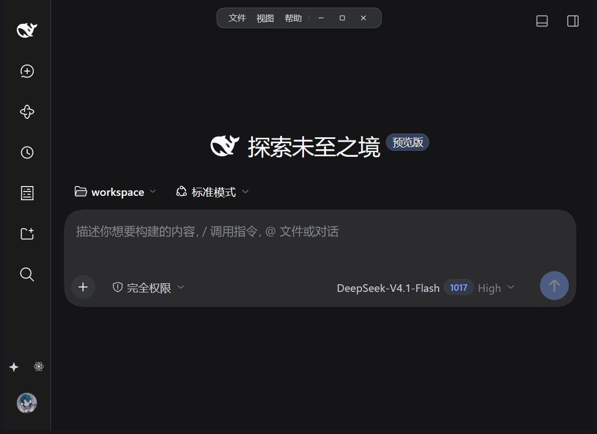
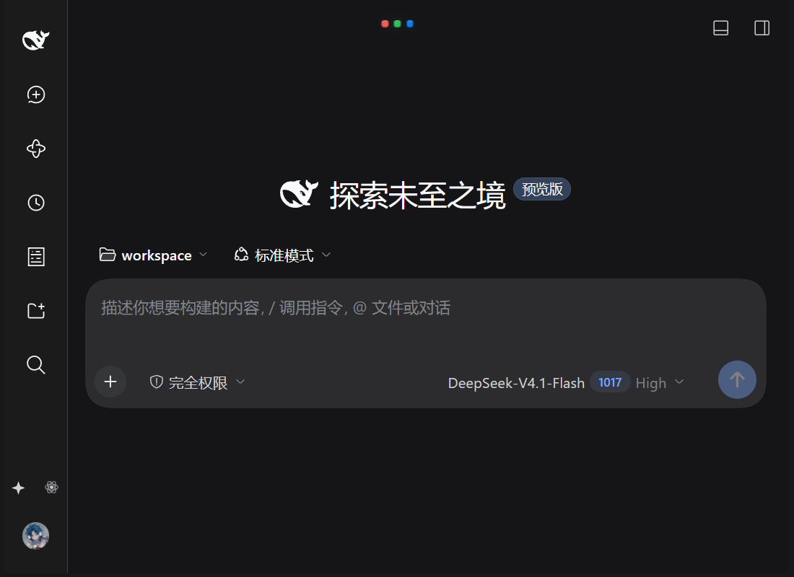

# dsh-frameless-page

为 **DSH-Portable** 增加顶部居中的「灵动岛」胶囊窗口 UI：网页铺满窗口、原生标题栏移出布局，窗口的拖动 / 最小化 / 最大化 / 关闭 / 全屏由胶囊交给外壳的原生实现。

> 这是一个 **DSH client 插件**，通过标准 DSH 插件安装命令装进 web profile。



| 待机（只显示三点） | 悬浮（只显示描边） |
| --- | --- |
|  | — |

## 功能

- **待机**：只显示三个点，胶囊面透明。
- **悬浮**：只显示胶囊描边，不展开。
- **单击**（按下→松开、位移 <3px）：展开；展开态单击背景收起。
- **拖动**：在胶囊任意非按钮区域按住移动 >3px，拖动整个 Windows 窗口。
- **展开行**：文件 / 切换至老UI / 视图 / 帮助 / 最小化 / 最大化 / 关闭；菜单命令由外壳原生命令执行。
- **全屏**：胶囊保持可见，点击胶囊或按 Esc 退出全屏。
- **顶部 5% 区域**：非控件区域按住拖动窗口；双击最大化/还原。
- **外观继承**：底色、描边、阴影、字体取自主对话框卡片；三个点在会话运行中交替闪烁。
- **新/老 UI 切换**：胶囊里切到原生标题栏（iOS 交通灯），原生「视图」菜单可切回；选择会记住。

## 前置条件（重要）

胶囊依赖配套外壳提供的能力：

- 外壳需要支持 `windowChrome` / `windowDrag` / `windowControls` / `windowState` 消息（`window.__DSH_PORTABLE_NATIVE__`，`windowChrome:true`）。
- 官方原版 `DeepSeek-Herness.exe` **没有**这个能力：插件会被跳过（不会报错，但也没有胶囊）。
- 配套外壳改动（无边框、胶囊模式、窗口命令、四边缩放等）见 DSH-Portable PR：<https://github.com/WSL043/DSH-Portable/pull/181>；集成说明见 `docs/immersive-island.md`。

## 安装（标准 DSH 插件方法）

`dsh plugin` 会把参数原样转发给 profile 目录里的 pnpm，所以支持 pnpm 的全部安装语法。安装后**重启 DSH** 生效（插件在 DSH 启动时加载）。

### 方式 A：从 GitHub 安装（推荐）

```powershell
# Windows / DSH-Portable
E:\DSH-Portable\dsh.exe plugin --profile web add github:ArtificialAngels/dsh-frameless-page

# 固定版本
E:\DSH-Portable\dsh.exe plugin --profile web add github:ArtificialAngels/dsh-frameless-page#v0.1.23
```

*非 Portable 安装：把可执行文件换成你的 `dsh`，profile 名按实际使用（默认 `web`）。*

### 方式 B：从 Release 的 tgz 安装

```powershell
E:\DSH-Portable\dsh.exe plugin --profile web add https://github.com/ArtificialAngels/dsh-frameless-page/releases/download/v0.1.23/dsh-frameless-page-0.1.23.tgz
```

### 方式 C：本地 tgz

```powershell
E:\DSH-Portable\dsh.exe plugin --profile web add file:E:/path/to/dsh-frameless-page-0.1.23.tgz
```

安装完成后退出 DSH（托盘右键 → 退出）再重新打开。

### 验证

```powershell
# profile 依赖与已安装版本
Get-Content E:\DSH-Portable\data\dsh-home\profiles\web\package.json
Get-Content E:\DSH-Portable\data\dsh-home\profiles\web\node_modules\dsh-frameless-page\package.json
```

启动日志里出现 `[plugin-cli] import-check-passed` 即表示插件导入检查通过。

## 卸载

```powershell
E:\DSH-Portable\dsh.exe plugin --profile web remove dsh-frameless-page
```

然后重启 DSH。

## 兼容性

- **DSH-Portable 0.9.x 外壳**（含窗口补丁）：胶囊正常工作。
- **原版外壳**：插件加载后直接跳过（无胶囊、无副作用）。
- 插件只改渲染层，不写 DSH 数据目录；状态记录在外壳的 `data/chrome-ui.json`（只剩新/老 UI 选择）。

## 开发

```powershell
# 只构建前端 bundle（不依赖打包器）
node scripts/build-client.mjs      # 输出 lib/client.js

# 本地安装测试
pnpm pack --pack-destination .artifacts
E:\DSH-Portable\dsh.exe plugin --profile web add file:E:/.../dsh-frameless-page-0.1.23.tgz
```

## License

MIT
